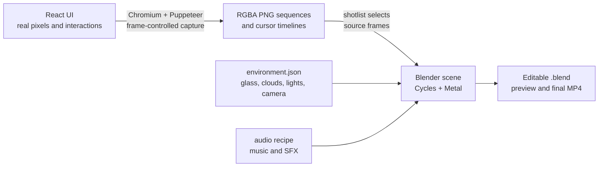

# SkyBao rendering architecture

SkyBao uses three deliberately separate layers:

1. **React is the product and UI source of truth.**
2. **Puppeteer converts that UI into deterministic transparent footage.**
3. **Blender/Cycles turns the footage into a cinematic film.**

Blender never runs React directly. It receives numbered PNG sequences rendered
by Chromium, then places those images on a crisp UI plane inside the 3D glass
scene.



## Responsibility boundaries

| Layer            | Owns                                                                                                                                                         | Does not own                                                                             |
| ---------------- | ------------------------------------------------------------------------------------------------------------------------------------------------------------ | ---------------------------------------------------------------------------------------- |
| React / Electron | Product layout, text, mock data, controls, state, real lightweight interactions, accessibility, app navigation, dark mode                                    | Glass, cinematic clouds, camera motion, depth of field, film transitions, final encoding |
| Capture system   | Deterministic frame clock, capture-only states, transparent framing, stable selectors, browser-driven interactions, RGBA PNGs, cursor coordinates, checksums | Product design decisions, 3D materials, editorial pacing, music                          |
| Blender / Cycles | Shot assembly, physical glass, refraction, frosting, lighting, clouds, camera, focus, panel flips, compositing, cursor layer, audio mix, output render       | Product behavior, UI copy, DOM layout, alternate hand-painted UI                         |

### React and the Electron app

The Electron app is not a second UI implementation. It hosts the same React
frontend and stages that build into `server/public` through
`yarn desktop:build`. A normal React UI change therefore appears in Electron
after the desktop frontend is rebuilt.

The SkyBao mock is primarily implemented in:

- `frontend/src/pages/NativeArea/index.jsx`
- `frontend/src/pages/NativeArea/AssistantStory.jsx`
- `frontend/src/pages/NativeArea/storyData.js`
- `frontend/src/pages/NativeArea/styles.css`
- shared application shell components such as `Sidebar`, `WorkspaceFrame`, and
  `CloudBackgroundLayer`

React owns everything that should be legible as product behavior: typing,
searching, opening a source, editing a draft, dragging a Kanban card, approving
a task, and navigating between product areas.

The deterministic Acme Assistant story is intentionally query-gated at
`/?demo=acme&autoplay=1`. The ordinary `/` route remains the real AnythingLLM
Assistant. Capture-specific behavior is additionally compiled behind
`VITE_SKYBAO_CAPTURE=1`, so artifact parameters cannot bypass the ordinary
application shell or authentication in a normal production build.

### Capture system

The capture system renders React in a real Chromium browser using Puppeteer. It
does not draw a second fake copy of the interface. Stable `data-capture-id`
selectors let the renderer drive the existing inputs, previews, approvals, and
dnd-kit board.

Its main files are:

- `frontend/scripts/video/skybao-assets.mjs` — asset catalog, states, durations,
  actions, and cursor choreography
- `frontend/scripts/video/capture-skybao-assets.mjs` — build, browser capture,
  staging, validation, and promotion
- `frontend/src/pages/NativeArea/capture.jsx` — capture-only frame clock exposed
  to React
- `artifacts/skybao-ui/catalog.json` — generated capture inventory and
  provenance

Artifact routes use:

```text
capture=transparent&artifact=1&framing=shell|workspace&state=<manifest-state>
```

In artifact mode, `window.__SKYBAO_CAPTURE__` exposes `ready`, `setFrame`, and
`getFrame`. React animation state derives from the requested frame instead of
wall-clock timers. That makes typing, research progress, drawer motion, and
interaction states repeatable.

Capture output lives under `artifacts/skybao-ui/`:

```text
artifacts/skybao-ui/
├── catalog.json
├── checksums.sha256
├── stills/{shell|workspace}/{area}/{asset}.png
├── clips/{area}/{asset}/frame-000001.png
├── clips/{area}/{asset}/timeline.json
└── cursor/cursor.svg
```

The UI pixels are silent 1920×1080 straight-alpha RGBA images. The cursor is
not baked into those pixels; its frame-numbered coordinates and click events
remain in `timeline.json` so Blender or another editor can render it separately.

### Blender and Cycles

Blender consumes the capture library as image sequences. The UI stays sharp on
an emissive plane, while separate geometry supplies the rounded glass cover,
frosted backing, thickness, refraction, shadows, and edge highlights. Moving
cloud cards sit behind the slab, which makes the glass effect readable without
blurring the interface itself.

The durable film recipe is split by responsibility:

- `frontend/scripts/video/film/shotlist.json` — 1,200-frame edit, shot order,
  source trims, same-face dissolves, navigation bridges, and four area flips
- `frontend/scripts/video/film/environment.json` — glass, clouds, lights,
  camera, bounded focus moves, Cycles profiles, Metal device policy, sampling,
  denoising, and light paths
- `frontend/scripts/video/film/build-blender.py` — constructs the portable 3D
  scene, editorial lower-thirds, focus moves, and editable `.blend`
- `frontend/scripts/video/film/render.mjs` — preflight, Blender invocation,
  frame validation, H.264/AAC encoding, reporting, and atomic promotion
- `frontend/scripts/video/film/handoff.mjs` — poster, contact sheets, review
  derivatives, and final checksums

The checked-in film contract is 1920×1080, 30 fps, 1,200 frames, and exactly 40
seconds. It contains 19 shots across Assistant, Knowledge, Communications,
Work, and Admin. The panel changes face only at the four major-area boundaries.

Cycles is the render engine. On Apple Silicon, `auto` prefers the Metal GPU and
disables CPU hybrid rendering; explicit `metal` fails if no Metal device exists.
The preview profile is 50% resolution at 32 adaptive samples. The final profile
is full resolution at 128 adaptive samples with GPU OpenImageDenoise.

Generated film output lives under `artifacts/skybao-film/`:

- `skybao-film.blend` — most recently generated editable scene
- `skybao-film-preview.blend` and `skybao-film-final.blend` — immutable
  profile-specific projects referenced by their reports
- `deliverables/skybao-40s-preview.mp4`
- `deliverables/skybao-40s-master.mp4`
- build manifests, render reports, poster, review sheets, provenance, and
  checksums

### Current revision artifact state

The canonical editable blend, canonical targeted review frames, build manifest, and
checksums represent this revision. Expensive profile-specific preview/final
blends and MP4 deliverables remain the previously approved render until a full
preview/final render is explicitly approved. The old master does not contain
these changes, and the 1,200-frame preview/final render is not part of revision
validation.

## Where a change belongs

| Requested change                                                              | Correct owner                                                   |
| ----------------------------------------------------------------------------- | --------------------------------------------------------------- |
| Change copy, data, layout, colors, controls, or interaction behavior          | React UI                                                        |
| Make typing, loading, drag, or drawer motion deterministic for capture        | React capture frame clock plus the asset manifest               |
| Add or retake a screen or interaction                                         | `skybao-assets.mjs` and Puppeteer capture                       |
| Change which UI frames appear, their order, or their duration                 | `shotlist.json`                                                 |
| Change glass, frosting, edge light, clouds, camera, focus, panel movement, or editorial graphics | `environment.json`/`shotlist.json` and `build-blender.py` |
| Change cursor path or click timing                                            | Capture `timeline.json` recipe; composite the cursor in Blender |
| Change music or sound effects                                                 | Audio recipe and Blender film assembly                          |
| Change samples, denoising, Metal/CPU selection, codec, or delivery validation | Render profile and `render.mjs`                                 |

Two rules keep the system maintainable:

- If a viewer should see a change while using the app, implement it in React.
- If a change exists only because a camera is filming the app, implement it in
  the capture or Blender layer.

Do not repaint UI text or controls in Blender. Do not add cinematic glass or
camera behavior to the Electron UI. Do not change normal application behavior
solely to make capture easier; use the gated artifact frame clock and selectors.

## Regeneration workflow

From the repository root:

```bash
# 1. Rebuild all stale React capture assets.
yarn video:assets --update

# Or retake only known owners after a focused UI change.
yarn video:assets --only=assistant-answer-typing,work-board-drag

# 2. Verify the complete capture library without writing it.
yarn video:assets:check

# 3. Validate the shot recipe, capture freshness, and Cycles device.
yarn video:film --check --cycles-device=metal

# 4. Render the recipe-owned canonical targeted review set.
yarn video:film --samples=targeted
# Ad-hoc samples are allowed for noncanonical visual checks.
yarn video:film --samples=60,150,241

# The focused scene-contract checkpoints are also available without a full render.
yarn video:film:scene-contract --repo . --blend artifacts/skybao-film/skybao-film.blend \
  --manifest artifacts/skybao-film/build-manifest.json

# 5. Build the editable scene and render the 960x540 review.
yarn video:film --build-only
yarn video:film

# 6. After review approval, render the 1920x1080 master.
yarn video:film --final

# 7. Explicitly refresh editor-facing derivatives after both current renders.
yarn video:film:handoff
```

Every film command checks the exact capture owners used by the shotlist. If UI
source, a capture recipe, or an owned PNG changes, the pipeline refuses to use
stale footage. Renders are assembled in staging and promoted only after frame
continuity, duration, color, audio, and black-frame checks pass.

## Practical revision examples

**Change a button label:** edit React, retake the owning capture asset, inspect
it, and rerender the film. Do not patch the label in Blender.

**Make the glass more frosted:** edit `environment.json`, render selected review
frames, then rerender. React and the capture library do not need to change.

**Hold the Work board two seconds longer:** change the shot timing/source trim in
`shotlist.json`. Recapture only if the existing clip does not contain enough
source frames.

**Change the cursor path:** update the capture action/timeline so the UI action
and cursor events share one frame clock, then recapture and rerender.

**Ship the UI without the film effects:** rebuild and run Electron normally.
The Blender glass, clouds, camera, flips, and depth of field are absent by
design.

For detailed capture flags and artifact format, see
`frontend/scripts/video/README.md`. For exact shot, Cycles, and review contracts,
see `frontend/scripts/video/film/README.md`.
